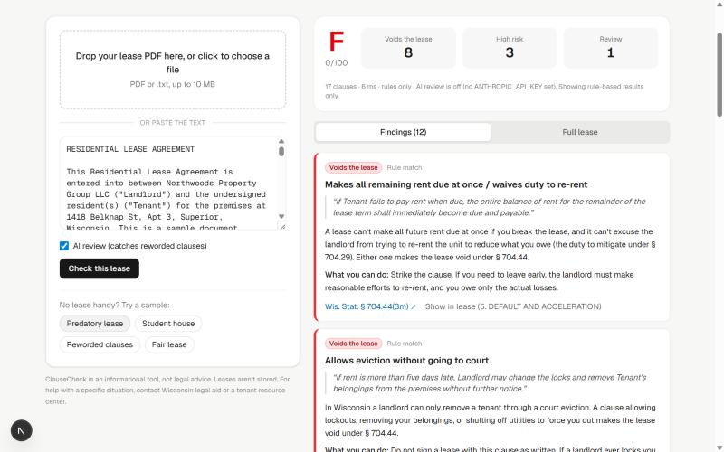
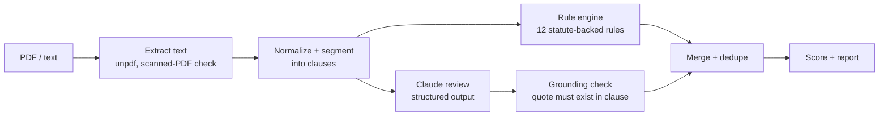
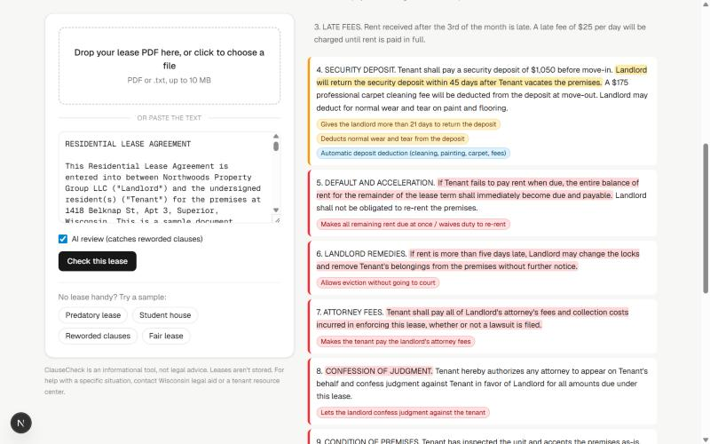

# ClauseCheck

**Find the illegal clauses in a Wisconsin rental lease before you sign it.**

Upload a lease PDF or paste the text. ClauseCheck splits it into clauses, flags terms that are unlawful or risky under Wisconsin law, explains each one in plain English, and links it to the statute behind it.



## Why

Most student renters sign a lease without reading it closely, and many leases still contain clauses Wisconsin law has banned, such as rent acceleration, attorney-fee shifting, confession of judgment, or "landlord isn't liable even if negligent." Under [Wis. Stat. § 704.44](https://docs.legis.wisconsin.gov/statutes/statutes/704/44), any one of these makes the **entire lease void and unenforceable**. Tenants almost never know that.

## How it works



1. **Extraction**: `unpdf` pulls text page by page. Image-only (scanned) PDFs are detected and rejected with a clear message instead of returning an empty report.
2. **Segmentation**: a heuristic splitter recognizes numbered sections, "Section N", and ALL-CAPS headings, falls back to paragraphs, and re-joins words hyphenated across PDF line breaks.
3. **Rule engine**: 12 rules covering § 704.44 (void provisions) and § 704.28 (security deposits). Each rule carries its citation, a plain-English explanation, and what the tenant can do about it. The detectors are deliberately conservative.
4. **AI review (optional)**: Claude (`claude-opus-5-5`) reviews every clause against the same catalog and returns schema-validated JSON. It catches clauses that say the same thing in different words, which the regexes miss.
5. **Grounding check**: every AI finding must quote the clause **verbatim**. Findings whose quote isn't actually in the lease are discarded, so the model can't invent problems. For catalog rules, severity and citations always come from the rule set, never from the model.
6. **Merge and score**: findings flagged by both passes are marked "Rule + AI". Each distinct issue costs points once, giving a 0–100 score and an A–F grade.



## Accuracy

`npm run eval` scores findings against hand-labeled sample leases in [`public/samples`](public/samples) ([labels](eval/labels.json)):

| Mode | Precision | Recall | F1 |
|---|---|---|---|
| Rules only | 100% | 75% | 85.7% |
| Rules + Claude | run `npm run eval -- --ai` with an API key | | |

All five rules-only misses are in `reworded-lease.txt`, which deliberately words the same violations in unusual ways. That's the gap the AI pass is designed to close. CI runs the rules-only eval and fails the build if precision drops below 95% or recall below 70%.

> Honest caveat: the rules were developed against these same samples, so rules-only numbers are optimistic. A larger held-out set of real leases is the next step (see Roadmap).

## Engineering notes

- **Treats lease text as untrusted input.** The system prompt tells the model the lease is data, not instructions, and the grounding check limits what a prompt-injected lease could do.
- **Degrades gracefully.** No API key, rate limits, refusals, truncated output, or network errors all fall back to rule-only results with a note. The analysis never fails because the AI did.
- **Refusal fallback.** Requests opt into the API's server-side fallback (`fallbacks: "default"`), so a safety-classifier false positive is retried on a fallback model.
- **Rate limiting.** `/api/analyze` uses a sliding-window limiter (10 requests/min per IP) and returns `429` with `Retry-After`.
- **Input validation.** PDF magic-byte check, 10 MB / 60-page limits, length bounds, and 413/415/422 error mapping.
- **Tests.** 46 Vitest tests, including table-driven detector cases, a PDF built in memory and round-tripped through extraction, and a mocked Claude client covering refusals and errors.

## Tech stack

| Layer | Tools |
|---|---|
| App | Next.js 16 (App Router, route handlers), React 19, TypeScript |
| UI | Tailwind CSS v4, responsive layout, dark mode |
| AI | Anthropic TypeScript SDK, Claude Opus 5.5, structured outputs with Zod |
| Parsing | unpdf (PDF.js) |
| Quality | Vitest, ESLint, custom precision/recall eval harness |
| Delivery | GitHub Actions CI, multi-stage Docker image (standalone Next.js, non-root) |

## Run it locally

```bash
npm install
cp .env.example .env.local   # optional: add ANTHROPIC_API_KEY to enable AI review
npm run dev                  # http://localhost:3000
```

```bash
npm test             # unit tests
npm run eval         # accuracy eval (rules only)
npm run eval -- --ai # include the Claude pass (needs ANTHROPIC_API_KEY)
```

API:

```bash
curl -X POST localhost:3000/api/analyze -F file=@lease.pdf
curl -X POST localhost:3000/api/analyze -H 'content-type: application/json' \
  -d '{"text": "...lease text...", "useAi": false}'
```

Docker:

```bash
docker build -t clausecheck .
docker run -p 3000:3000 -e ANTHROPIC_API_KEY=sk-... clausecheck
```

## Project layout

```
src/lib/rules/wisconsin.ts   statute-backed rule catalog
src/lib/segment.ts           text normalization + clause segmentation
src/lib/engine.ts            rule runner, evidence extraction, scoring
src/lib/ai/review.ts         Claude review, grounding check, merge
src/lib/analyze.ts           end-to-end pipeline
src/lib/pdf.ts               PDF extraction + scanned-document detection
src/app/api/analyze/route.ts HTTP API with rate limiting
src/components/              upload panel and report UI
eval/                        labeled eval harness
```

## Roadmap

- Held-out eval set of real (anonymized) leases
- OCR for scanned PDFs
- Side-by-side comparison of two leases
- Shareable reports (Postgres) and Redis-backed rate limiting for multi-instance deploys
- More states (Minnesota is next door)

## Disclaimer

ClauseCheck is an informational tool, not legal advice. Sample leases in this repo are synthetic. For help with a specific situation, contact Wisconsin legal aid or a tenant resource center.
